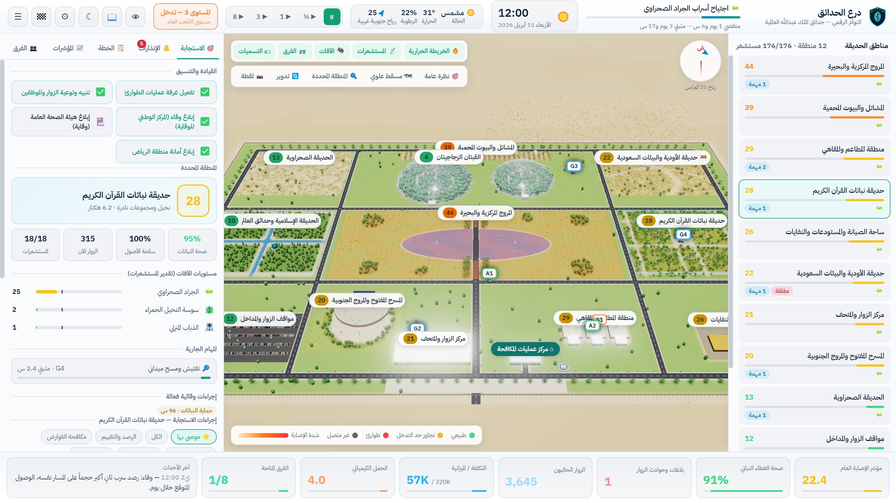

# درع الحدائق — التوأم الرقمي لمكافحة الآفات والقوارض

**GardenShield Twin — Pest & Rodent Control Digital Twin**

منصة توأم رقمي ثلاثي الأبعاد لمحاكاة مكافحة الآفات والقوارض في **حدائق الملك عبدالله العالمية** بالرياض. تتضمن 10 سيناريوهات اجتياح، و176 مستشعراً ذكياً، و32 إجراء استجابة، وتقييماً من 100 مع تقرير PDF بعد كل سيناريو.

## ⬇️ التحميل

| الملف | الوصف |
|---|---|
| [**GardenShield-Twin-Setup-1.1.0.exe**](https://github.com/asfantrading-create/GardenShield-Twin/releases/latest/download/GardenShield-Twin-Setup-1.1.0.exe) | المثبّت (يُنشئ اختصاراً على سطح المكتب وقائمة ابدأ) |
| [**GardenShield-Twin-Portable-1.1.0.exe**](https://github.com/asfantrading-create/GardenShield-Twin/releases/latest/download/GardenShield-Twin-Portable-1.1.0.exe) | نسخة محمولة تعمل مباشرة بدون تثبيت |
| [**GardenShield-Twin-User-Guide-AR-EN.pdf**](https://github.com/asfantrading-create/GardenShield-Twin/releases/latest/download/GardenShield-Twin-User-Guide-AR-EN.pdf) | دليل المستخدم بالعربي والإنجليزي مع صور توضيحية |

صفحة كل الإصدارات: [Releases](https://github.com/asfantrading-create/GardenShield-Twin/releases)

## متطلبات التشغيل

- Windows 10 أو 11 (64-بت)
- ذاكرة 8 جيجابايت
- بطاقة رسوميات تدعم WebGL 2
- شاشة بدقة 1366×768 أو أعلى (يُفضّل 1920×1080)

> **ملاحظة:** إذا ظهر تحذير Windows SmartScreen عند أول تشغيل، اختر «مزيد من المعلومات» ثم «تشغيل على أي حال».

**الترخيص:** فترة تجريبية مدتها 14 يوماً تبدأ من أول تشغيل. للتفعيل الكامل افتح «حول البرنامج والترخيص» من القائمة الرئيسية وأرسل معرّف الجهاز إلى المورّد.

---

## English

A 3D digital-twin platform that simulates pest and rodent control at **King Abdullah International Gardens**, Riyadh. It includes 10 outbreak scenarios, 176 smart sensors, 32 response actions, and a score out of 100 with a PDF report after every scenario.

### Download

- [Installer — GardenShield-Twin-Setup-1.1.0.exe](https://github.com/asfantrading-create/GardenShield-Twin/releases/latest/download/GardenShield-Twin-Setup-1.1.0.exe)
- [Portable — GardenShield-Twin-Portable-1.1.0.exe](https://github.com/asfantrading-create/GardenShield-Twin/releases/latest/download/GardenShield-Twin-Portable-1.1.0.exe)
- [User guide (Arabic / English) — PDF](https://github.com/asfantrading-create/GardenShield-Twin/releases/latest/download/GardenShield-Twin-User-Guide-AR-EN.pdf)

**Requirements:** Windows 10/11 (64-bit), 8 GB RAM, a WebGL 2 graphics card, and a screen of 1366×768 or larger.

If Windows SmartScreen warns you on first launch, choose "More info" and then "Run anyway". The software includes a 14-day trial; activate it from "About & Licence" in the main menu.

© 2026 GardenShield. All rights reserved.
